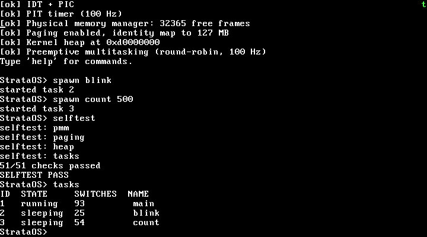

# 🪐 StrataOS

> A small educational 32-bit x86 kernel in C, featuring memory management, preemptive multitasking, user space, and a minimal storage stack.

Initially conceptualized as *miniOS*, StrataOS currently implements up to **Phase 4** of its development plan. It is built to run in QEMU, providing a robust playground for understanding core operating system concepts. 

---

## 📖 Table of Contents
- [Architecture & Status](#-architecture--status)
- [Features by Phase](#-features-by-phase)
- [Screenshots](#-screenshots)
- [Shell Commands & Usage](#-shell-commands--usage)
- [Build and Run](#-build-and-run)
- [Verification & Testing](#-verification--testing)
- [Roadmap](#-roadmap)
- [License](#-license)

---

## 🏗 Architecture & Status

**Status:** Phases 1–4 Completed.

*   **Concurrency:** Kernel threads and built-in ring-3 tasks coexist seamlessly. 
*   **Memory Isolation:** Kernel pages are supervisor-only. User tasks share a single page directory (they are not isolated from each other).
*   **Limitations:** There is no external program loader (ELF), and user programs cannot read files directly; the filesystem is accessed exclusively via the kernel shell. Tested exclusively in QEMU, not on bare metal.

> **Note on AI Assistance:** This project was prepared with AI assistance following a kernel expansion plan. The code was written and tested fresh rather than copied from raw outputs, with design differences documented in [`docs/ARCHITECTURE.md`](docs/ARCHITECTURE.md). It is not a from-scratch solo effort, nor was it built over two months.

---

## ✨ Features by Phase

### Core System
- Multiboot compliant boot sequence.
- Flat GDT, IDT, PIC, 100 Hz PIT timer.
- I/O: PS/2 keyboard, VGA text mode, COM1 serial console.
- Interrupt-safe kernel heap and console.

### Phase 1: Memory Management
- **PMM:** Bitmap-based Physical Memory Manager driven by the Multiboot memory map (with double-free protection).
- **Paging:** 4 KiB-page paging (map/unmap/translate) with a page-fault handler.
- **Kernel Heap:** Growable first-fit heap with coalescing, alignment, and corruption checks.

### Phase 2: Preemptive Multitasking
- Preemptive round-robin kernel threads.
- Task table of 16 entries, utilizing 8 KiB heap-allocated stacks with canaries.
- Timer-interrupt context switching, `task_sleep`, process killing, and stack reaping.

### Phase 3: User Space (Ring 3)
- Ring-3 code/data segments and 32-bit TSS with per-task kernel entry stacks.
- Safe interrupt entries (saves/restores segments, clears DF).
- `int 0x80` system calls: bounded console write, yield, exit, sleep, and a single zeroed 4 KiB user allocation.
- Protection: Read-only user code, RW stack, supervisor-only kernel pages. Invalid syscalls return negative error codes; user faults terminate the task without crashing the kernel.

### Phase 4: Storage & Filesystem
- **Disk Driver:** Polled ATA PIO driver for the primary-bus master (IDENTIFY, LBA28, bounded waits, error returns, cache flush).
- **StrataFS:** A custom, strictly-validated minimal filesystem. Supports directories, 31-character names, and up to 64 entries. Files are allocated as single contiguous extents up to 64 KiB.
- *Safety First:* Metadata is validated on mount. Corrupted or unformatted disks are refused and left untouched (no auto-format).

---

## 📸 Screenshots

| Boot Sequence | Phase 2 Execution |
| :---: | :---: |
|  |  |
| *System initialization and console.* | *Blinking `t` (top right) indicates a running task alongside a passing selftest.* |

---

## 💻 Shell Commands & Usage

The integrated serial and keyboard shell supports a variety of commands for testing kernel subsystems.

**Available Commands:**
`help`, `meminfo`, `uptime`, `selftest`, `frame`, `unframe`, `malloc`, `free`, `heapcheck`, `translate`, `tasks`, `spawn`, `kill`, `user`, `crash`, `halt`, `diskinfo`, `format`, `ls`, `cat`, `write`, `mkdir`, `rm`, `cd`, `pwd`, `fsinfo`, `mkfile`, `verify`

### Multitasking (Phase 2)
```bash
spawn blink     # A 't'/'T' blinks in the top-right corner while shell remains responsive
spawn count 20  # Spawns a counting task
tasks           # Lists all running tasks
kill 2          # Kills task with ID 2
```

### User Space Tests (Phase 3)
```bash
user demo       # Checks CPL=3, syscall errors, allocation, sleep/yield; prints USER DEMO PASS
user spin       # Never yields; shell remains responsive; use `tasks` and `kill ID` to terminate
user fault 1    # Deliberate fault: touch supervisor heap; task faults, shell survives
```
*(Fault probes 1-7 test deliberate task termination, including supervisor heap read, CLI, port I/O, code write, privileged IRQ, null read, and bad user stack).*

### Storage & StrataFS (Phase 4)
*Note: `make run` automatically creates a 10 MB `disk.img` if it does not exist.*
```bash
diskinfo             # View model and size of the ATA disk
format yes           # First-time setup: creates StrataFS (erases the file table on this disk)
write hello.txt Hi   # Writes text to a file (takes the rest of the line, up to 127 chars)
mkdir docs           # Creates a new directory
write docs/note.txt inside docs
ls                   # Lists docs/ and hello.txt
cat docs/note.txt    # Reads and prints file contents
cd docs              # Change directory (also: pwd, cd .., ls PATH, rm PATH, fsinfo)
mkfile big 65536     # Generates N bytes of test data
verify big 65536     # Verifies the generated test data
```

---

## 🚀 Build and Run

**Prerequisites:** 
Linux (or Docker) with `make`, `qemu-system-x86`, and a `gcc` capable of targeting 32-bit (`gcc-multilib`).

```bash
make            # Builds build/kernel.elf
make run        # Boots it in QEMU (-m 128) with disk.img attached
make test-host  # Runs PMM, heap, and filesystem tests under ASan/UBSan
make test-qemu  # Boots in QEMU and runs automated shell tests
```

**macOS Users:** Building requires an i686 cross-toolchain (e.g., `i686-elf-gcc`). You can run `make CC=i686-elf-gcc`. *(This path is currently untested).*

---

## 🧪 Verification & Testing

StrataOS is strictly tested to ensure stability across its subsystems:
- **Compiler:** Built with GCC 11.4 using strict warnings (`-Werror`).
- **Host Tests:** 11,596 host checks passed under ASan/UBSan, including rigorous filesystem tests featuring write-failure injection and corrupted metadata validation.
- **QEMU Tests:** 61 assertions passed across 15 automated boots in QEMU 6.2. Tests cover an in-kernel `selftest`, ring-3 execution, and disposable disk image tests (format, write/read, persistence, corrupt image refusal, and disk full states).
- **CI/CD:** Configuration available in `.github/workflows/ci.yml`.

---

## 🗺 Roadmap

No further phases are currently planned for this repository. 
*Ideas explored but not implemented: Executable loader (ELF), per-process virtual address spaces, block cache, and FAT filesystem compatibility.*

---

## 📄 License

*No license file is included yet.*
