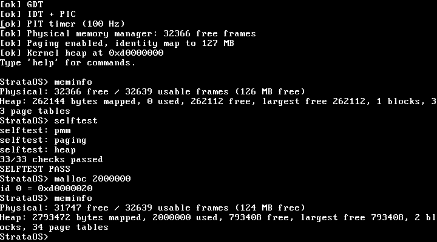

# StrataOS

A small educational 32-bit x86 kernel in C with a little assembly. **Phase 1: memory management** - physical memory manager, paging, kernel heap (`kmalloc`/`kfree`) - plus the minimal boot, console, interrupt and shell code needed to run and test it.

Formerly called miniOS in its planning notes. Status: Phase 1 only. No processes, scheduler, user mode, disk or filesystem yet. Runs in QEMU; not tested on real hardware.

**AI assistance:** this project was prepared with AI help (following a memory-subsystem plan from a Gemini chat). The code was written and tested fresh rather than copied from that chat, and the design differences are listed in [docs/ARCHITECTURE.md](docs/ARCHITECTURE.md). It is not a from-scratch solo effort, and it was not built over two months.

## Features
- Multiboot boot, flat GDT, IDT, PIC, 100 Hz PIT timer, PS/2 keyboard, VGA text + COM1 serial console
- Bitmap PMM driven by the Multiboot memory map, with double-free protection
- 4 KiB-page paging with map/unmap/translate, page-fault handler
- Growable first-fit heap with coalescing, alignment and corruption checks
- Serial/keyboard shell: `help meminfo uptime selftest frame unframe malloc free heapcheck translate crash halt`

## Build and run
Linux (or Docker) with `gcc` able to target 32-bit (`gcc-multilib`), `make`, `qemu-system-x86`:

    make            # builds build/kernel.elf
    make run        # boots it in QEMU (-m 128)
    make test-host  # PMM + heap tests under ASan/UBSan
    make test-qemu  # boots in QEMU and drives the shell

On macOS, building needs an i686 cross toolchain (e.g. `i686-elf-gcc`; run `make CC=i686-elf-gcc`). That path is untested here.

## Verified
Built with GCC 11.4 (warnings as errors), 10,142 host checks passed, 14 QEMU 6.2 boot scenarios passed (see `tests/`). CI config is in `.github/workflows/ci.yml` (not yet run).

## Roadmap (planned, not implemented)
These are future phases and do not exist in this repo yet:
- Phase 2: process control blocks, context switching, preemptive round-robin scheduler
- Phase 3: ring 3 user mode, `int 0x80` system calls
- Phase 4: ATA PIO disk driver and a simple filesystem

## License
No license file is included yet.
